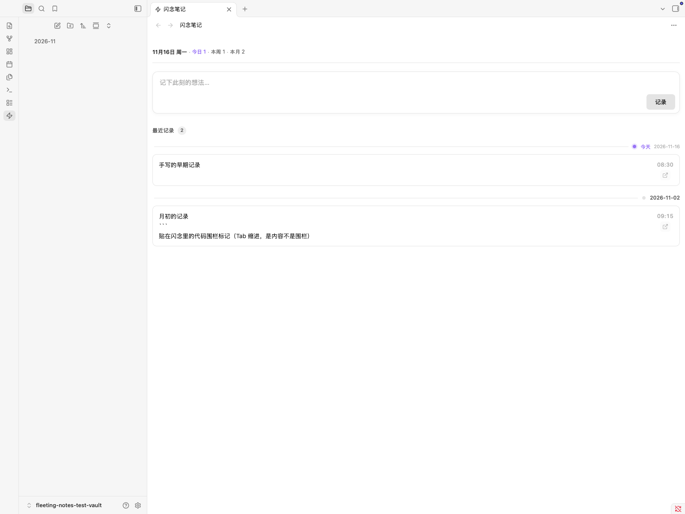
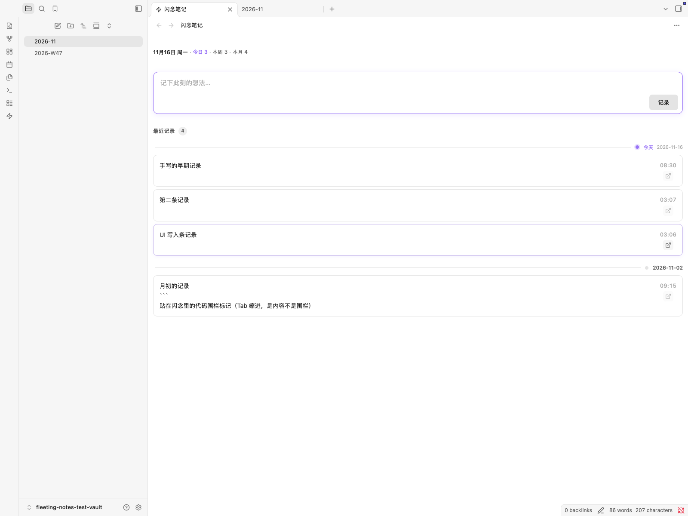
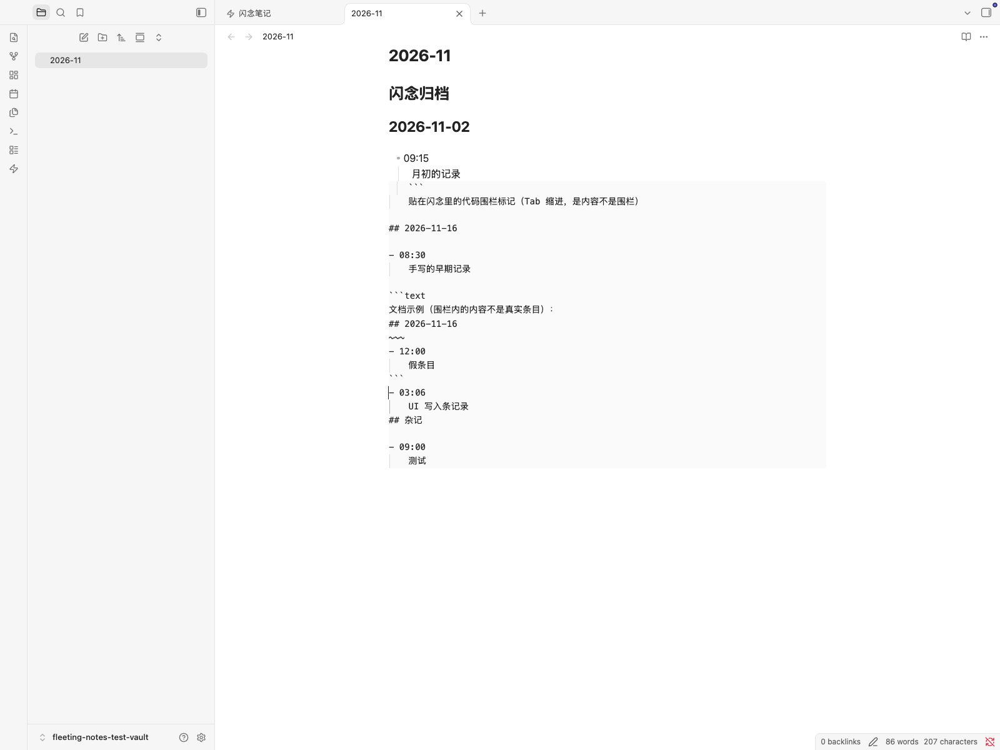
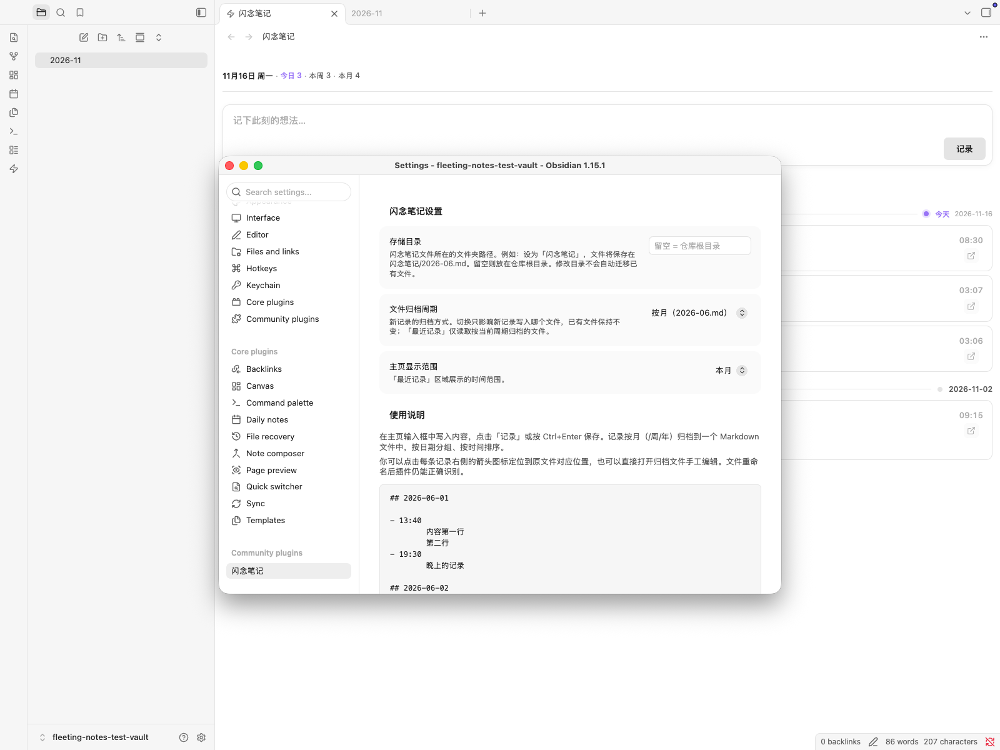

# 闪念笔记 (Fleeting Notes Capture)

## 📥 下载安装（小白版）

1. 打开本仓库的 [Releases 页面](https://github.com/duany2026/obsidian-fleeting-notes/releases)，下载最新版本的 `fleeting-notes-capture-1.2.2.zip`
2. 解压，得到文件夹 `fleeting-notes-capture`
3. 打开你的 Obsidian 笔记库文件夹，进入隐藏目录 `.obsidian/plugins/`（如果没见过这个目录：在 Obsidian 里点左下角仓库图标 →「在系统资源管理器中显示仓库」，进去就能看到 `.obsidian`）
4. 把解压出的 `fleeting-notes-capture` 文件夹整个放进去，变成 `.obsidian/plugins/fleeting-notes-capture/`（里面应有 `main.js`、`manifest.json`、`styles.css`）
5. 重启 Obsidian → 设置 → 第三方插件 → 关闭「安全模式」→ 在已安装插件列表中启用「闪念笔记」

> 进阶：也可以安装 [BRAT](https://github.com/TfTHacker/obsidian42-brat) 插件，添加仓库地址 `https://github.com/duany2026/obsidian-fleeting-notes`，以后可自动更新。


一个 Obsidian 插件：在主页面板内快速记录零散想法（闪念），自动按周期归档到 Markdown 文件，按日期分组展示，支持手机端。

## 功能

- **快速记录**：主页输入框写入内容，点击「记录」或按 `Ctrl+Enter`（桌面端）保存
- **自动归档**：记录按周期写入一个归档文件，按日期分组、同日条目按时间正序追加（主页列表最新在前）
- **灵活周期**：支持按月（`2026-06.md`）、按周（`2026-W23.md`）、按年（`2026.md`）归档
- **最近记录**：主页展示本月 / 本周 / 今日记录，带计数徽章
- **定位原文**：点击条目右侧箭头图标，直接跳转到归档文件中对应位置
- **容错性强**：归档文件重命名后仍可识别；日期标题带备注（如 `## 2026-06-01 会议`）也能正确追加与解析
- **手机端可用**：`isDesktopOnly: false`，含移动端布局适配

## 界面预览

| 主页 | 最近记录 |
| --- | --- |
|  |  |

| 归档文件格式 | 设置页 |
| --- | --- |
|  |  |

## 安装

手动安装：

1. 下载 `main.js`、`manifest.json`、`styles.css`
2. 放入 `<你的库>/.obsidian/plugins/fleeting-notes-capture/`
3. 设置 → 第三方插件 → 启用「闪念笔记」

## 使用方法

- 点击左侧功能区闪电图标，或运行命令 **打开闪念笔记主页**
- 在输入框中写入内容，点击「记录」或按 `Ctrl+Enter` 保存
- 记录右侧箭头图标可定位到原文件对应行
- 命令 **打开当前归档文件** 可直接打开正在写入的归档文件

## 文件格式

归档文件示例：

```markdown
## 2026-06-01

- 13:40
	内容第一行
	第二行
- 19:30
	晚上的记录

## 2026-06-02

- 08:15
	早上写的
```

格式约定：

- `## YYYY-MM-DD` 为日期分区标题，可在日期后附加备注，**备注与日期之间需以空格分隔**（`## 2026-06-01 会议`；写成 `## 2026-06-01会议` 会被视为一个新的日期分区，追加与解析两侧判定一致）
- `- HH:MM` 为条目时间戳，内容以 Tab 缩进，支持多行
- 手写的日期标题支持不补零（如 `## 2026-9-5`），插件会自动归入对应日期

## 设置项

| 设置 | 说明 |
| --- | --- |
| 存储目录 | 归档文件所在文件夹，留空为库根目录。修改后不会迁移已有文件 |
| 文件归档周期 | 新记录按 月 / 周 / 年 归档，切换不影响已有文件 |
| 主页显示范围 | 「最近记录」区域展示 本月 / 本周 / 今日 |

## 行为说明

- 归档文件名可重命名（如加后缀），插件优先使用标准名 `2026-06.md`；找不到标准名时，只有文件名以同周期开头**且内容符合归档格式**的文件才会被当作备胎，普通笔记不会被误认或误写。使用非标准命名的归档文件时，插件会在首次写入时提示一次记录的写入位置并记住该文件名，之后不再重复提示
- 修改存储目录不会自动迁移已有文件，可手动移动后由插件重新识别
- 同一周期内若存在多个可识别文件，写入目标以标准文件名为准

## 开发

插件由 `src/` 下的 TypeScript 源码经 esbuild 打包为 `main.js`，本仓库发布产物不含源码。本地修改 `main.js` 后重启 Obsidian 或重载插件即可生效。

发布打包时只包含 `main.js`、`manifest.json`、`styles.css`（可选 `versions.json`），**不要携带本地 `data.json`**——其中存的是作者本机的个人设置（如存储目录），会干扰新用户的初始化。

## 版本记录

### 1.2.4（2026-11-17）

问题修复与发版方式调整。**界面和操作方式都没有变化**。

- 改进：发版方式与其他插件统一——发行版现在带 `main.js`/`manifest.json`/`styles.css` 三个独立文件，Obsidian 客户端可直接更新（以前只发压缩包，客户端认不到）
- 加固：保存后插件自己的写入事件现在一定被识别，不再偶发多刷一次页面
- 内部：几个界面定时器改为跟踪管理，关闭面板或重载插件时不再残留

### 1.2.3（2026-11-16）

- 修复：在归档文件里手写其他标题小节（如 `## 杂记`）时，其下的时间记录不再被算进上一个日期，主页列表不再出现「不属于那天」的条目
- 修复：归档文件被手工编辑后，「定位到原文件」可能跳到另一条时间相近的记录——现在会核对时间，对不上就重新搜索
- 修复：归档文件中代码块（``` 围栏）里的示例日期标题和时间行不再被误当成真实分区与记录，新记录也不会被写进代码块里
- 修复：页面开着过夜后「今日/本周/本月」徽标仍停在昨天——现在跨零点自动刷新；跨月/跨周/跨年后新记录也会正确写入新的归档文件
- 修复：同步盘产生的冲突副本（如 `2026-06 1.md`）不再被选作写入目标，避免新记录写进迟早被清理的残片文件
- 改进：记录一条闪念后主页只刷新一次，不再重复渲染
- 修复：连续快速修改设置时，偶发「设置已保存」的提示先于真实落盘

### 1.2.2（2026-10-24）

- 修复：向 CRLF 行尾的归档文件追加记录时，新增行混入裸 LF——现新增行全部跟随文件已有行尾（与「重要日子」插件同口径）；解析侧同步剥离内容行尾的 `\r`，LF 原件与 CRLF 备份副本这类跨行尾风格的重复记录也能正确合并为一条
- 改进：禁用/卸载插件时关闭主页视图，不再残留死视图
- 文案：「文件归档周期」设置说明更正——切换周期后「最近记录」仅读取按当前周期归档的文件，旧周期文件中的历史不会出现在列表（原文案「历史记录仍可在列表中查看」言过其实）

### 1.2.1（2026-09-02）

- 修复：同一分钟内记录的两条完全相同内容，主页列表只显示一条（去重键现附带条目在文件内的出现序号；跨文件的备份副本仍会正确合并为一条）
- 修复：解析侧日期分区标题补齐边界判定，`## 2026-09-051` 这类畸形标题不再被静默归入 2026-09-05，与追加侧行为一致
- 修复：归档备胎的内容识别收紧为「时间戳行后紧跟 Tab 缩进内容行」，带时间清单的普通笔记（如会议纪要）不再被误认为归档文件
- 修复：同时打开多个主页视图（拆分页签）时，文件变更事件现会刷新全部主页视图，而非仅第一个
- 修复：主页视图重建时旧 ResizeObserver 未断开，可能产生滞留的冗余回调
- 修复：存储目录输入含非法值（如 `..` 段）被净化后，输入框现会立即回显净化结果
- 体验：同分钟同内容的重复记录正确显示；带时间清单的普通笔记不再被误认成归档文件；拆分多开的主页视图实时同步刷新；长期使用不再积累冗余回调

> 1.2.0 及更早版本的变更未单独记录版本日志。
